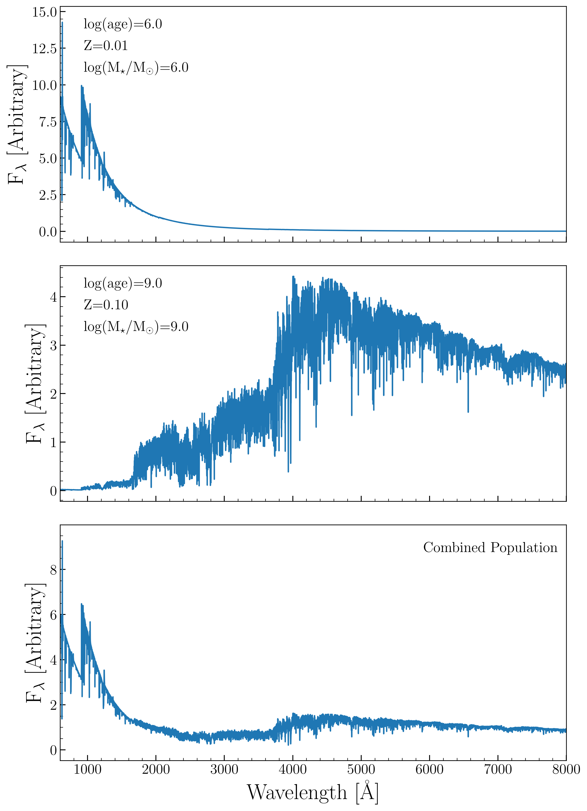

{: .float-left style="width 25%"}
I am producing a set of python routines that integrate with [cloudy](https://gitlab.nublado.org/cloudy/cloudy) to fit the code into a typical pythonic workspace. In combination with [BPASS](https://warwick.ac.uk/fac/sci/physics/research/astro/research/catalogues/bpass/), these routines can produce a custom ionising spectrum consisting of multiple stellar populations. Current [examples](https://github.com/ra-cooper/cloudy_tools) also show how to build a working cloudy input file with python.

{: .clear}

{: .float-right style="width 25%"}
As well as producing cloudy ready inputs, I am developing routines that produce machine readable, python friendly outputs from cloudy results. These outputs overcome cloudy's typical format to work directlty with your favourite, ascii table reading, python packages. The most up-to-date progress on this work can be found [here](https://github.com/ra-cooper/cloudy_tools).

{: .clear}

### To do:
- Improve flexibility for filename handling.
- More user friendly translations of cloudy's output headers.
- Save information on non-varied parameters.
- Improve stellar population building routines.
- Package everything.

