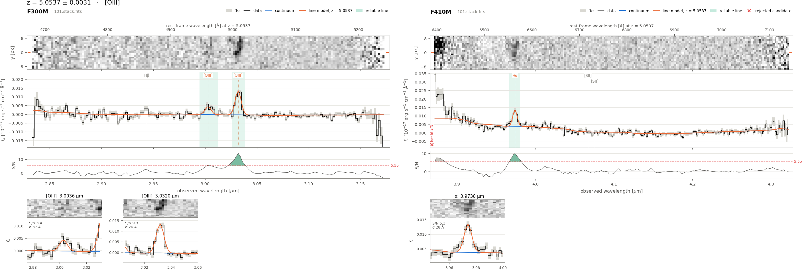

I am actively developing a robust NIRCam WFSS pipeline that accomodates all filter and GRISM combinations. Example notebooks are available [here](https://github.com/ra-cooper/wfss_tools). This pipeline builds off of the [grizli](https://github.com/gbrammer/grizli/) code and follows the reduction steps outlined in [Kashino+23](https://arxiv.org/abs/2211.08254). 

### To do:
- Introduce continuum modelling for bright foreground sources.
- Additional masking steps informed by imaging.
- Implement multi-wavelength source catalog for contamination and extraction steps.

As well as the image reduction, I am actively working on a line detection routine to help sort the immense datasets WFSS images typically produce. This routine is in heavy development, but early results are shown above!

### To do:
- Fine tune selection parameters.
- Optimise selection for high-redshift sources.
- Combine with photometric redshifts to inform line searching.
- Implement quality control, reject lines based on set criteria.

### If you are interested in any of this work, please feel free to contact me!